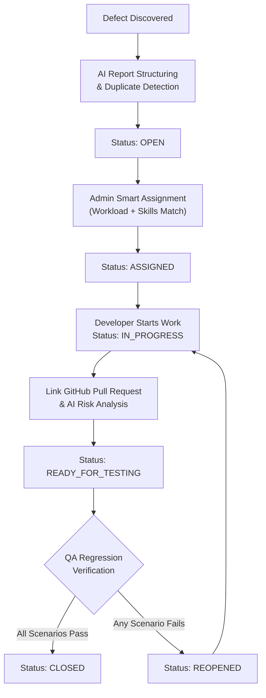

# BugTrack AI — Comprehensive User Manual & Operations Guide

Welcome to **BugTrack AI**, an enterprise software issue management platform that connects defect reporting, artificial intelligence, GitHub pull requests, and regression testing into a single closed-loop lifecycle.

---

## 1. System URLs & Access

| Component | URL | Purpose |
|---|---|---|
| **Web Application (SPA)** | [http://localhost:5173](http://localhost:5173) | Primary user interface for all roles |
| **REST API Server** | [http://localhost:5000](http://localhost:5000) | Express backend & data services |
| **Health Check Endpoint** | [http://localhost:5000/api/health](http://localhost:5000/api/health) | System health & AI engine status |
| **GitHub Webhook Listener** | `http://localhost:5000/api/webhooks/github` | Webhook receiver for repo events |

---

## 2. Authentication & Demo Credentials

For local development and demonstrations only, the platform can be populated with pre-seeded accounts configured with distinct roles and permissions. Do not use these credentials in production; the demo seeder refuses to run when `NODE_ENV=production`.

> [!TIP]
> **1-Click Quick Fill**: On the [Login Page](http://localhost:5173/login), click any of the role cards (**Admin**, **QA Tester**, **Developer**) to automatically fill the credentials.

| Role | Email | Password | Primary Capabilities |
|---|---|---|---|
| **Admin** | `admin@bugtrack.ai` | `Admin@123` | Create projects, allocate developers, triage priorities, view global analytics |
| **QA Tester** | `tester@bugtrack.ai` | `Tester@123` | AI bug report generator, duplicate detection, submit regression verifications |
| **Developer** | `developer@bugtrack.ai` | `Developer@123` | View assigned defects, start work, link GitHub PRs, review AI risk analysis |
| **Developer (Backend)** | `alex.dev@bugtrack.ai` | `Dev@12345` | Secondary developer account for capacity & workload testing |
| **Developer (Frontend)** | `sarah.fullstack@bugtrack.ai` | `Dev@12345` | Secondary developer account for UI/UX skill matching tests |

---

## 3. End-to-End Bug Lifecycle Architecture

BugTrack AI enforces a 6-stage finite state machine with strict role-based access control:



---

## 4. Role-Based Step-by-Step Operations

### Workflow A: Filing a Bug with AI (QA Tester)
1. Log in with **`tester@bugtrack.ai`** (`Tester@123`).
2. Click **"Report Bug (AI)"** in the top navigation or sidebar.
3. Select your target project (e.g. *FinPay Digital Banking*).
4. Enter an informal, plain-English observation in the **Raw Defect Observation** box:
   ```text
   When clicking the profile picture upload button, uploading a 3MB image causes an HTTP 413 error and the app hangs on a loading spinner.
   ```
5. Click **"Generate Structured Report with AI"**:
   - The engine parses the prompt into Title, Executive Summary, numbered Steps to Reproduce, Expected vs. Actual results, Severity, and Priority.
   - The active AI engine badge will indicate **Google Gemini 1.5 Flash** or **BugTrack Local Deterministic Fallback Engine**.
6. **Live Duplicate Detection**:
   - As you type or generate, the system compares tokens against existing issues in the project and displays a similarity score with overlapping keywords.
7. Review and adjust any fields in the form.
8. Scroll to **"Recommended Developer Assignment"** to preview suggested assignees based on capacity and skills.
9. Click **"Approve & Submit Bug Report"**.

---

### Workflow B: Smart Developer Assignment (Admin)
1. Sign in with **`admin@bugtrack.ai`** (`Admin@123`).
2. Navigate to **"Admin Command"** (`/admin`).
3. Under the **Unassigned Issues Queue**, locate the newly reported defect.
4. Click **"Smart Assign"**:
   - A modal displays engineers ranked by an AI composite score.
   - The algorithm awards points for matching skills (e.g., *React, Node, Uploads*) and applies penalties for existing active workloads (`OPEN`, `ASSIGNED`, `IN_PROGRESS`, `REOPENED`).
5. Select the recommended engineer and click **"Confirm Assignment"**.
   - Issue status advances to **`ASSIGNED`**.
   - An audit event is recorded in the activity timeline.

---

### Workflow C: Code Remediation & AI Risk Analysis (Developer)
1. Sign in with **`developer@bugtrack.ai`** (`Developer@123`).
2. Navigate to **"Developer Hub"** (`/developer`).
3. Locate the defect in **My Assigned Defects Queue**.
4. Click **"Start Work"**:
   - Issue status transitions to **`IN_PROGRESS`**.
5. After implementing the fix, click **"Link PR"**:
   - Enter a public GitHub PR URL (e.g., `https://github.com/facebook/react/pull/28419`) or leave it blank to simulate a patch.
   - Click **"Link PR & Run AI Risk"**.
6. Inspect the generated **AI Code Change Risk Analysis Panel**:
   - **Risk Level Badge**: `LOW`, `MEDIUM`, or `HIGH`
   - **Change Summary**: Architectural overview of developer code changes
   - **Affected Modules**: Blast radius of modified files
   - **Potential Risk Areas**: Specific architectural, auth, or DB risks
   - **Suggested Regression Test Cases**: Recommended verification checklist
   - **Missing Scenarios**: Boundary edge cases
7. The issue status automatically advances to **`READY_FOR_TESTING`**.

---

### Workflow D: Regression Testing & Verification (QA Tester)
1. Sign in as **`tester@bugtrack.ai`** (`Tester@123`).
2. Navigate to **"QA Verification"** (`/tester`).
3. Under **"Ready For Testing Queue"**, click **"Verify Fix"** on the target defect.
4. Review the **Regression Testing & Verification Protocol**:
   - The checklist displays the scenarios generated by the AI Code Change Risk Analysis.
   - Mark each scenario **Pass** or **Fail**.
   - Input optional verification notes in the text area.
5. **Execution Outcome**:
   - **Pass All**: If every check passes, click **"Pass All & Close Issue"** ➔ Status transitions to **`CLOSED`**.
   - **Fail One or More**: If any check fails, click **"Fail & Reopen Issue"** ➔ Status automatically transitions to **`REOPENED`** and alerts the developer.
   - A permanent verification entry is added to the **Regression Verification History**.

---

### Workflow E: Telemetry & Project Management (Admin)
1. **Main Dashboard (`/dashboard`)**:
   - View aggregated counts across all projects.
   - Analyze dynamic Recharts:
     - *Issues by Status* (Donut distribution)
     - *Defects by Severity* (Bar distribution)
     - *Issues by Priority* (Bar distribution)
     - *Developer Workload & Capacity* (Active vs. Resolved)
     - *Issue Creation Velocity* (14-day trend line)
   - Use the project filter dropdown in the top right to isolate specific project telemetry.
2. **Project Management (`/projects`)**:
   - Click **"New Project"** to initialize a new codebase workspace.
   - Link public GitHub repository URLs.
   - Click into any project to manage team memberships (`ADMIN`, `TESTER`, `DEVELOPER`) or delete workspaces.
3. **Team Management (`/team`)**:
   - Search developers by name, email, or domain skill keywords (e.g., `React`, `PostgreSQL`, `Security`).

---

## 5. Navigation & Routes Reference

| Route | Page Name | Minimum Role |
|---|---|---|
| `/login` | Sign In Page | Public |
| `/register` | Account Registration | Public |
| `/dashboard` | Main Analytics Dashboard | Any Authenticated |
| `/admin` | Admin Operations Center | `ADMIN` |
| `/tester` | QA Testing & Verification Queue | `TESTER` or `ADMIN` |
| `/developer` | Developer Workspace | `DEVELOPER` or `ADMIN` |
| `/projects` | Project Workspaces List | Any Authenticated |
| `/projects/:id` | Project Details & Team Roster | Any Authenticated |
| `/issues` | Issue Tracker Master Registry | Any Authenticated |
| `/issues/create` | AI Bug Report Generator | `TESTER` or `ADMIN` |
| `/issues/:id` | Issue Detail, PR Risk & Verification | Any Authenticated |
| `/github` | GitHub Hub & PR Risk Workbench | Any Authenticated |
| `/team` | Engineering & QA Directory | Any Authenticated |
| `/profile` | User Profile & Skills Editor | Any Authenticated |
| `/settings` | System Diagnostics & AI Settings | Any Authenticated |

---

## 6. CLI Management Commands

Execute these commands from the root directory (`C:\Users\tamil\.gemini\antigravity\scratch\bugtrack-ai`):

```powershell
# Start both Backend and Frontend concurrently in development mode
npm run dev

# Run automated integration tests (18 tests across Auth, Issues, AI, GitHub)
npm run test

# Compile production build of the frontend
npm run build

# Apply the Prisma schema without resetting or seeding database records
npm run db:setup

# Populate demo records only in a new, empty database
npm run db:seed
```

---

## 7. Configuration & Environment Variables

Environment variables are located in `server/.env`:

Use unique random values for `JWT_SECRET` and `WEBHOOK_SECRET`; never commit real secrets or reuse placeholders in production.

```env
PORT=5000
DATABASE_URL="file:./dev.db"
JWT_SECRET="<generate-a-unique-secret>"
JWT_EXPIRES_IN="7d"
NODE_ENV="development"
CORS_ORIGIN="http://localhost:5173"

# Optional External API Keys
GEMINI_API_KEY=""      # Supply a Gemini API key to activate Gemini 1.5 Flash
GITHUB_TOKEN=""        # Supply a GitHub Personal Access Token for higher rate limits
WEBHOOK_SECRET="<generate-a-unique-secret>"
```

In development, unset secrets are generated randomly for that server process, so restart requires signing in again. For production, replace both placeholders with separate random values of at least 32 characters; missing or placeholder secrets are rejected.

> [!NOTE]
> When `GEMINI_API_KEY` is not provided, BugTrack AI runs on its **Local Deterministic Fallback Engine**, ensuring that bug structuring, duplicate detection, and PR risk analysis continue operating offline.
